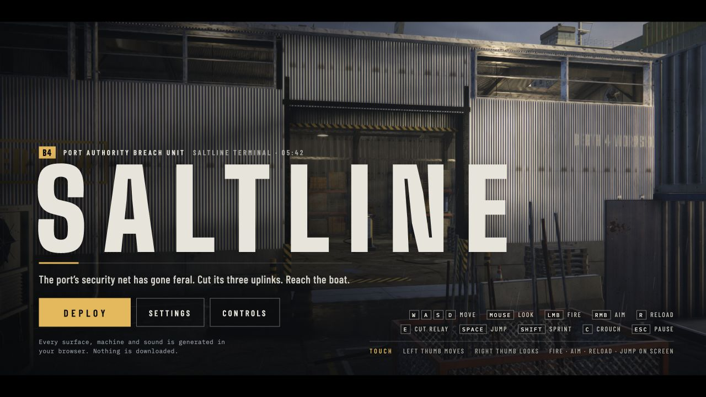
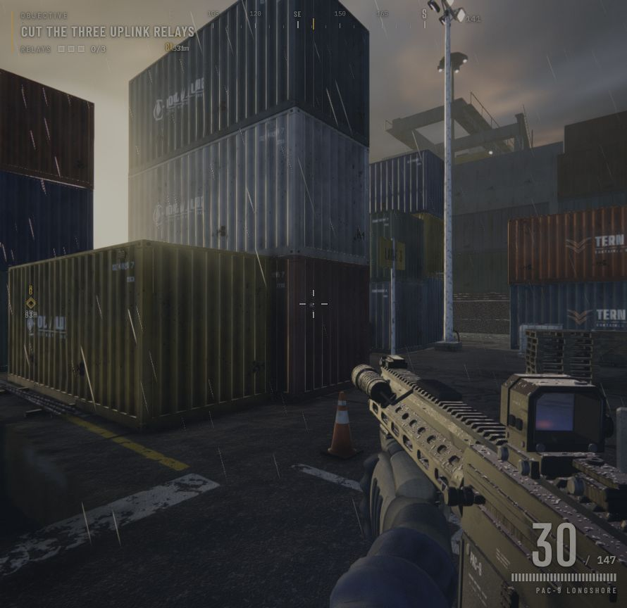
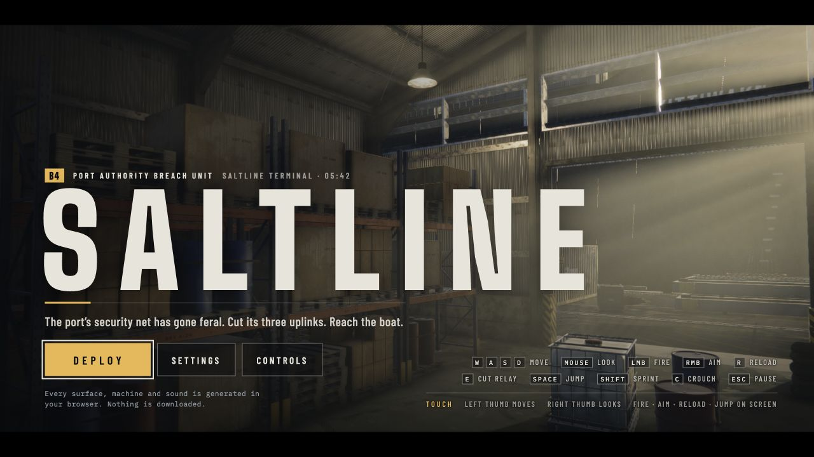

# 本地恢复验收

日期：2026-11-10。来源：[Saltline Artifact](https://claude.ai/artifact/BGY1SztrAYcJQHSsnHHGmp)，公开版本 `1794242702-61c7`。

## 完整性

- 公开版本清单只包含一个 `index.html`，1,423,413 字节。
- 下载页面移除 Claude 注入的 40,960 字节 frame runtime 后，原件 SHA-256 与发布清单一致：`f7081ef7b2fde5880e3c58184c720b2aa3b9115efe58ff71b48f6820d4f16f90`。
- 将原件内的 JS/CSS 与当前文件分别交给同一版本 Prettier 格式化后比较，内容完全相等。
- 22 个字体文件逐个校验大小与 SHA-256 通过。
- Three.js 保持原版 r180，未升级引擎、替换素材或改动玩法。

## 构建

- Node.js 26.8.2、npm 11.19.1，Vite 8.3.7，Prettier 3.9.10。
- `npm run check` 通过：游戏脚本语法检查、原件和字体校验。
- `npm run build` 通过，输出 `dist/`，包含 HTML、JS、CSS、source map 和全部 22 个字体文件。
- 原版引擎与游戏保持单 bundle，生产 JS 约 1.38 MB（gzip 约 429 KB）；Vite 会显示大 chunk 提示，构建成功。

## 浏览器验收

使用本机的 Codex 内嵌 Chromium 浏览器，分别访问开发服务 `http://127.0.0.1:5173/` 和生产预览 `http://127.0.0.1:4173/`。

| 项目 | 实际结果 |
| --- | --- |
| 启动、3D 场景 | 开发版与构建版均达到 `window.__ready === true`，标题场景正常渲染 |
| 字体与资源 | 三组字体检查均通过；两次运行记录中的 HTTP 资源请求全部指向各自的 `127.0.0.1` 服务，无外部资源请求 |
| 设置菜单 | 正常打开/关闭，显示画质、灵敏度、音量、FOV 等原版选项 |
| 部署 | 点击 Deploy 进入 intro，再进入 playing |
| 移动 | 按 W 后玩家从 `[-32, 0, 6]` 移动到约 `[-29.30, 0, 6]` |
| 转向与射击 | 方向键转向生效；Enter 开火后弹匣由 30 变为 27 |
| 装填 | R 触发 reloading，完成后弹匣恢复 30，备弹从 150 变为 147 |
| 暂停/继续 | P 进入 paused，Resume 返回 playing |
| 音频启动 | 用户操作后原版 WebAudio AudioContext 进入 running |
| 运行错误 | 开发版和构建版的 `__fatal` 均为空，`__errors` 均为空数组 |

结构化记录见 `runtime-dev.json` 与 `runtime-production.json`。记录的 FPS 是采样瞬间数据，不作为性能基准。

## 截图

开发版标题：

开发版实际战斗画面：

构建版标题：

## 验收范围

本次完成启动、基本键盘操作、UI 和构建烟测，没有通关三中继任务，也没有验证移动设备、实体手柄和不同浏览器。内嵌测试浏览器未提供鼠标捕获，已使用原版提供的方向键/Enter 替代操作验证转向和射击；独立 Chrome 中的 Pointer Lock 尚未单独测试。音频验证到 AudioContext 启动，未进行听觉品质评估。

## M1 环境系统验收（2026-11-13）

新增 `core/environment.js` 与 `core/environment-presets.js`，提供时间/天气/能见度中枢。以下截图与改造前对比均使用同一 `?shot=1&q=test&seed=4207&dt=0&noaudio=1&cam=-32,1.68,6,0,1.68,6` URL。

### shot 模式默认环境对比

| 项目 | 结果 |
| --- | --- |
| 天空 | `uZen` 已对齐 shader 原常量，无差异 |
| 太阳色/强度 | `DEFAULT_ENV = dawn` 复用 `SUN_LIGHT`，无差异 |
| 雾 | `fogDensity ≈ 9.1e-5`，不可见，无差异 |
| 曝光 | `exposure = 1.0`，无差异 |
| 地面湿度 | `wetApplied = false`，`mats.uniforms.wet` 保持 1，无差异 |
| 武器湿度 | `weaponWetness` 初始值取自 `environment.wetness`（1），无差异 |

### 时间/天气模式截图

使用 `?time=midnight&weather=heavyRain` 启动：

- 天空变暗（zenith 低亮度）
- 雾浓度显著升高（`FOG_K` 叠加 heavyRain.fogAdd）
- 地面雨量上升（`ground.setRain(0.9+)`）
- 地面湿度上升（`environment.wetness ≈ 0.85`）
- 武器视图模型湿度同步上升
- `ambientIntensity` 降低，整体氛围变暗
- `environment:changed` 事件派发成功，HUD 与音频表现正常

### 画质降级验证

使用 `?q=low` 启动，调用 `__G.environment.apply()`：

- `render.rebakeEnvironment()` 在 low 画质下为空操作（不重建 PMREM）
- `__G.render.env` 保持启动时的默认环境贴图
- 其他 setter（`setFog`/`setSun`/`setExposure`/`setRain`/`wetness`）均正常生效

### 初始化顺序与错误处理

| 项目 | 结果 |
| --- | --- |
| 初始化位置 | `ground` 之后、`effects` 之前 |
| URL 参数生效 | `?time=midnight&weather=heavyRain` 在启动时 `force: true` 应用 |
| 必需性 | 缺失会导致 `runtime` 致命错误 |
| 降级 | 无 Fallback（必需系统） |

## M3 直升机系统验收（2026-11-13）

新增 `world/helicopter.js`，并接入 `enemies.forceExpose`、`hud.expose`、`helicopter:spot`、`audio/library.js` 的 `helicopter` 循环音色、`environment._applyStatic` 启停与 `runtime` 装配。

### 静态与构建

| 项目 | 结果 |
| --- | --- |
| `npm run check` | 通过：69 模块语法/导入/无环检查 + `createHelicopter` 契约 + 归档与字体校验 |
| `npm run build` | 通过：74 模块，`dist/index.html` 1,430.50 kB（gzip 441.63 kB） |
| 归档校验 | `archive/original.html` 曾因 `core.autocrlf=true` 检出为 CRLF 导致 SHA-256 与 manifest 不符，已恢复 LF；本修改未触碰该文件 |

### 无头逻辑冒烟（临时脚本，已删除）

19/19 通过，覆盖：`combine` 的 `helicopterEnabled`（midnight+clear/overcast 为真，rain/非午夜为假）、启停幂等、盘旋初始位置、光柱轴线上 `isInBeam=true`、锥体外/零距离为 false、停用后立即清音效与暴露、`helicopter:spot` 事件派发。

### 浏览器验收

| 场景 | 预期 | 状态 |
| --- | --- | --- |
| `?time=midnight&weather=clear` | 直升机盘旋、光柱、旋翼音效、HUD 暴露标记 | 待人工复验 |
| `?time=midnight&weather=heavyRain` | 无直升机（`lightning=true`） | 待人工复验 |
| 夜间晴→雨切换 | 立即停光柱 + 停音效 + 清暴露 | 待人工复验 |
| 敌人/玩家进入光柱 | `investigate` + HUD 标记（上限 3，1.8s） | 待人工复验 |
| `?shot=1` 回归 | 默认 dawn/clear 无直升机，画面与 M1/M2 一致 | 待人工复验 |

### 与 M3.md 的偏差记录

| 偏差 | 原因 |
| --- | --- |
| 光束 SpotLight 独立创建，不复用 `render.lightPool` | 池内只有 `PointLight`，无 `SpotLight`；池归还后光柱会熄灭 |
| `setModel` 留空函数而非调用 `context.scene` | M3 明确不接模型（§1.2/§3.9） |
| `isInBeam` 距离粗筛在锥体判定之前 | 等价于方案描述，且物理上距离先筛更快 |
| 音效 `setEnabled(false)` 用 0.12s 淡出代替硬停 | 避免 WebAudio 爆音；听觉上等同立即停止 |
| `audio.js` 未改动 | 现状 `loop()` 句柄已有 `setPos/setGain/setPitch/stop`，无需改 |
| runtime 装配顺序为 `helicopter` → `environment` | 保证 environment 构造时 `applyStatic` 能检测到直升机（M3.md §4.7.1 的顺序要求） |

## M4 雷暴系统验收（2026-11-13）

新增 `effects/lightning.js`，并接入 `environment._onLightningFlash` / `scanLightningExpose`、`enemies.forceExpose`（M3 交付）、`renderer` 的 `post.flash`、`hud` 的 `lightning:exposed` 与准星泛白。

### 静态与构建

| 项目 | 结果 |
| --- | --- |
| `npm run check` | 通过：70 模块 + `createLightning` 契约 + 归档与字体校验 |
| `npm run build` | 通过：75 模块，`dist/index.html` 1,433.51 kB（gzip 442.47 kB） |

### 无头逻辑冒烟（临时脚本，已删除）

33/33 通过，覆盖：`lightningEnabled` 四种天气矩阵、`_applyStatic` 启停联动、`heavyRain` 8–12s / `lightRain` 16–20s 调度、`thunder` 强度（1.0 / 0.6）、夜晚 `postFlash=true`、白天与 `low` 画质 `postFlash=false`、`lightningT=0.8`、`current` 跳到峰值、连续闪电取 max 不叠加、`lambda=5` 在 0.8s 衰减到 1/e 内且不过冲、`scanLightningExpose` 只暴露「距离内 + LOS 可达 + 非 engage」的敌人、`lightning:exposed` payload、`game.state` 非 playing 冻结调度、非雨天不启用。

光锥几何另做了一次独立验证（顶点落 `beam.origin`、底面中点落 `origin+dir*range`、底面半径 = `tan(halfAngle)*range`，偏差均 0.000m）。

### 浏览器验收

| 场景 | 预期 | 状态 |
| --- | --- | --- |
| `?time=midnight&weather=heavyRain` | 8–12s 一次闪电，全屏闪白 + 天空闪 + 雷声，能见度瞬时升到 88.2m | 待人工复验 |
| `?time=midnight&weather=lightRain` | 16–20s 一次，强度较弱 | 待人工复验 |
| `?weather=clear` / `overcast` | 无闪电 | 待人工复验 |
| `?time=noon&weather=heavyRain` | 只有天空提亮，**无**全屏闪白 | 待人工复验 |
| `?q=low&weather=heavyRain` | 无全屏闪白（`envFlash=false`） | 待人工复验 |
| `?time=midnight&weather=heavyRain` | **无直升机**（`lightning=true`） | 待人工复验 |
| 闪电后敌人 | LOS 可达者 `investigate`，HUD 标记出现，已在 `engage` 的不降级 | 待人工复验 |

### 与 M4.md 的偏差记录

| 偏差 | 原因 |
| --- | --- |
| 未改 `walker.js` / `drone.js` | 与 M4.md §4.3 决策一致：暴露扫描统一走 `environment.scanLightningExpose`，敌人侧订阅会重复 `forceExpose` 与多一次 LOS |
| `environment` 新增 `lampOn` getter | M4.md 的 `_flash` 需要 `environment.lampOn` 判定夜晚，但 M1 未暴露该字段 |
| `post.flash` 增加逐帧衰减 | **M4.md 漏项**：原版只有 game flow 写 `post.flash = 0`，从不衰减；闪电写入后会永久泛白。`renderer.frame()` 内按 `exp(-3.2*dt)` 收敛 |
| `renderer` 订阅放在 `N` 定义之后 | 订阅回调访问 `N.post.flash`；写在 `N` 之前会踩 TDZ |
| `_flash` 的 `night` 用 `dusk.lampOn=0.7` 也判夜晚 | M4.md §10 第 10 条明确标注需确认；黄昏雷雨天色已暗，全屏 flash 合理。若认为过亮，改 `NIGHT_LAMP_ON` 一处即可 |

## M5 表现层与降级验收（2026-11-13）

目标：音频天气层、灯光、地面反射、`?show=environment`、HUD 收尾。

### 静态与构建

| 项目 | 结果 |
| --- | --- |
| `npm run check` | 通过：72 模块 + 契约 + 归档与字体校验 |
| `npm run build` | 通过：77 模块，`dist/index.html` 1,441.61 kB（gzip 445.40 kB） |

### 前置契约核实（推翻方案中的 2 个假设）

开工前逐项核对了 M5.md §2 与 §8 的 28 条依赖，发现两处方案前提与实际代码不符：

| 方案假设 | 实际情况 | 处置 |
| --- | --- | --- |
| `effects.setRainIntensity(level)` 驱动「全局雨幕粒子」，`envRainParticles` 控制粒子数 | **`effects.js` 完全没有雨幕系统**。雨幕是 `world/ground/water.js` 的内部 shader（`rain` + `splash` 两个 mesh），已由 `ground.setRain` 驱动，自带 `b ≈ 0.8/s` 平滑与 `visible = rainLevel > 0.01`，**没有可调粒子数** | 不新增 `effects.setRainIntensity`（会是死代码）；`envRainParticles` **确认无消费方**，已在 WIKI 记录。雨幕强度已由 M1 的 `ground.setRain(rainLevel)` 正确驱动 |
| `backdrop.lamps` 有 `emissive/emissiveIntensity`，`traverse` 设 `emissiveIntensity` | `lamps` 是 `pb()` 合批的**单个 `MeshBasicMaterial`**（`vertexColors` + 自定义闪烁 shader），**无 emissive** | `setLights` 改用 `visible + opacity`（关闭时 `opacity=0` 且 `visible=false`），保留闪烁 shader 相位 |

另外确认：`level.skylights` 是**天窗位置数据数组** `{x,y,z,w,d}`（不是灯光对象），只有 `shedLights` 是 4 盏 `PointLight`（intensity 34、distance 13）。

### 无头逻辑冒烟（临时脚本，已删除）

三组共 56 项断言全部通过：

| 组 | 覆盖 |
| --- | --- |
| environment 驱动（26） | 音频倍率随 `environment:changed` 更新、`lampOn` 阈值、`level/backdrop.setLights` 调用、`setReflections` 的 `planar && wet` 组合（含 `planar=0` 时雨天也关）、showcase 模块形状与推进、**全 `null` 子系统不抛错** |
| 真实 audio.js（19） | `setWeather/setTimeOfDay` 存在、4 种天气倍率映射、4 种时间 mood 映射、非法值回退、`environment:changed` 全量/偏量/`null` payload、`update()` 在 `weatherMul` 生效后不抛错 |
| 真实灯光实现（11） | `backdrop` 的 `visible/opacity` 三档（午/黎明/午夜）+ `transparent` 标记；`level` 的 34 → 13.6 → 0 → 34 **无漂移**、`0.05` 阈值两侧行为 |

### 浏览器验收

| 场景 | 预期 | 状态 |
| --- | --- | --- |
| `?weather=heavyRain` vs `clear` | 雨声/风声明显差异，海声略降 | 待人工复验 |
| `?time=midnight` / `noon` / `dusk` / `dawn` | 音乐氛围分别偏 dark / bright / warm / calm | 待人工复验 |
| `?time=midnight` | 远景灯 + 棚区 4 盏点光亮；`noon` 全灭；`dawn` 半亮 | 待人工复验 |
| `?weather=heavyRain` / `clear` | 地面反射开/关；`?q=low` 恒关 | 待人工复验 |
| `?show=environment` | 每 6s 换时间、每 4s 换天气，直升机/闪电随之启停 | 待人工复验 |
| `?shot=1` 回归 | `dawn/clear`：反射关、棚灯 `0.4×`、音频 `calm` | 待人工复验 |

### 与 M5.md 的偏差记录

| 偏差 | 原因 |
| --- | --- |
| **不实现 `effects.setRainIntensity`**（G4/G10） | 前后端均无雨幕粒子系统；雨幕是 ground 内部 shader。新增接口是死代码 |
| **不消费 `QUALITY_PRESETS.envRainParticles`** | 同上，没有可钳制的粒子数。字段保留（无副作用） |
| `backdrop.setLights` 用 `opacity` 而非 `emissiveIntensity` | 材质是 `MeshBasicMaterial`，无 emissive |
| `level.setLights` 只处理 `shedLights` | `skylights` 是位置数据数组，不是灯光对象 |
| `weather/musicMood` 用 `Object.defineProperties` 而非 `Object.assign` getter | **实机 bug**：`Object.assign` 会把 getter **求值成快照**，导致 `setWeather` 后读到的仍是初值。首轮测试 9 项失败即此原因 |
| `audio.update` 只改 4 行（乘 `weatherMul`） | `setWeather` 直接写 gain 会被下一帧 `update` 覆盖；方案 §3.1.1 自己也指出了这点 |
| HUD 准星闪白与暴露投影未重做 | M4 已加 `.h-cross.flash` + 闪白订阅；M3 已实现世界坐标投影。M5 只确认，不重复实现 |

## 平衡参数同步验收（2026-11-13）

依据 `docs/游戏参数设计方案.md` 落地策划平衡数值，覆盖 §1–§8。

### 静态与构建

| 项目 | 结果 |
| --- | --- |
| `npm run check` | 通过：73 模块 + 契约 + 归档与字体校验 |
| `npm run build` | 通过：78 模块，`dist/index.html` 1,446.01 kB（gzip 446.76 kB） |
| 无头冒烟（临时脚本，已删除） | **66/66 通过** |

### 落地清单

| 项 | 改动 |
| --- | --- |
| §1 | `ENEMY_TUNING.sightRange` 45 → **120** |
| §3 | 新增 `runNoise/walkNoise/crouchNoise`（20/8/2），订阅 `player:step` 调 `alert`，0.8s 节流 |
| §4 | `WEATHER_PRESETS.spreadScale` lightRain 1.05→**1.15**、heavyRain 1.15→**1.35** |
| §5 | 新增 `effects/solarflare.js` + `SOLAR_FLARE_TUNING`；`perception` 暴露 4 个 debuff getter |
| §6 | `LIGHTNING_PEAK_CAP = 120`；雷声延迟 1.8–2.8s；间隔 14–26/6–12；雷声遮蔽 +0.3 / 3s |
| §7 | `HELICOPTER_TUNING` 全部填实（45/28/6/14°/40/0.25/30） |
| §8 | `flow.js` 新增 `pickLane` + `laneBrief`，开局按 Lane 播报 |
| §9 | walker/drone 移速与攻速接 debuff；weapon 摆动 ×1.8；hud 标记抑制 |

### 冒烟覆盖要点

- **§2 矩阵逐格核对**：16 格全部命中设计值（dawn/clear 120 … midnight/heavyRain 25），极差 4.8×
- **§3 遮蔽实算**：奔跑 heavyRain 5.6m、行走 2.24m、开枪 12.6m
- **§6 先闪后雷时序**：`trigger()` 后 flash 立即、thunder 未发；t=1.0s 仍无；t≈3.2s 到达并打开 3s 遮蔽（0.72→0.85 封顶）；窗口过期后回到 0.72
- **§6 峰值**：夜雨 88.2m、昼雨封顶 120m
- **§5 耀斑包络**：起升 0.25s 时 level≈0.5 **且 debuff 未生效**；进入峰值后 4 个 debuff 全开；回落段 debuff 关闭；结束派发 `solarflare:end`
- **§5 触发门控**：午夜/雨天均 `enabled=false`，dusk+clear 为 true
- **§8 Lane**：8 个组合全对

### 过程中发现并修复的 bug

| bug | 说明 |
| --- | --- |
| **`lightning.js` 出现两个 `update` 定义** | 插入延迟雷声逻辑时保留了旧版 `update`，后者覆盖前者，导致雷声永不播放（测试 3 项失败暴露）。已删除重复定义 |
| 测试自身时机错误 | `audioMask` 有 damp 过渡，切换天气后需等收敛再断言遮蔽叠加；已改为先跑 240 帧 |

### 浏览器验收

| 场景 | 预期 | 状态 |
| --- | --- | --- |
| 白天晴（dawn/noon/dusk × clear） | 敌兵视距 120m；每 25–45s 出现耀斑，敌方变慢、玩家摆动加剧、HUD 标记断供 | 待人工复验 |
| 雨天（任意时间） | 视距 45–110m；雨里奔跑只到 5.6m；弹道明显散；先闪后雷 | 待人工复验 |
| 夜晴 | 直升机 radius 45 / height 28 / 6m/s，绕圈约 47s，14° 窄光柱 | 待人工复验 |
| 夜雨 | 视距 25m、闪电 6–12s、无直升机 | 待人工复验 |
| 开局简报 | 按 Lane 播报对应战术提示 | 待人工复验 |

### 未纳入本次同步

| 项 | 原因 |
| --- | --- |
| 耀斑的 `post` 视觉层（过曝/眩光/扫描线）与电子嗡鸣音效 | 设计稿 §5.4 要求，但需要改 `postprocessing` shader 与新增合成音色；本次只输出 `perception.solarFlare` 强度供后续消费 |
| `TIME_PRESETS.ambient` / `sunDir` | 属 `游戏参数.md` §4 的 #2/#3 遗留项，不在本次设计方案范围内 |
| `环境切换仅标题/暂停菜单可用` | 设计稿 §9 提到，但涉及 `menus.js`/`flow.js` 交互重构，且与当前 M2 已实现的下拉行为冲突，需单独确认 |
